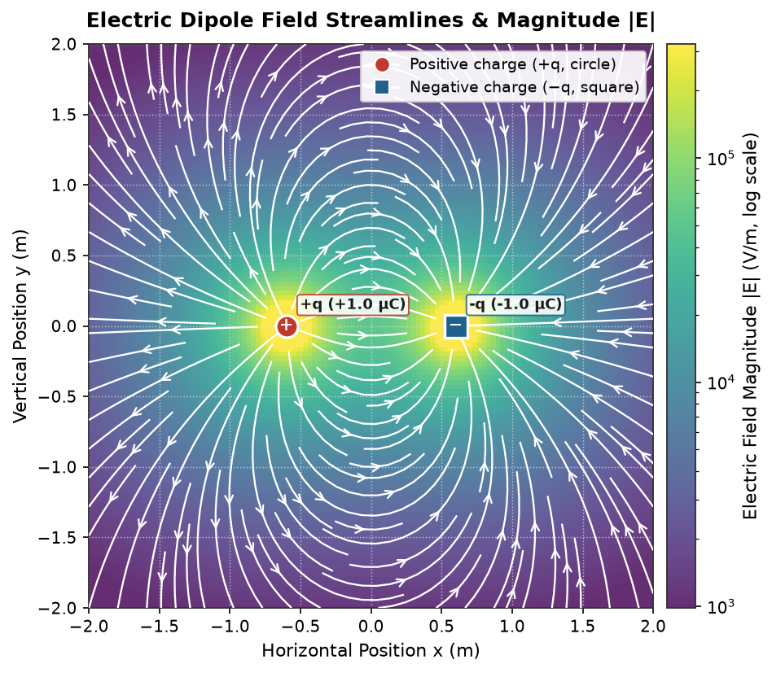
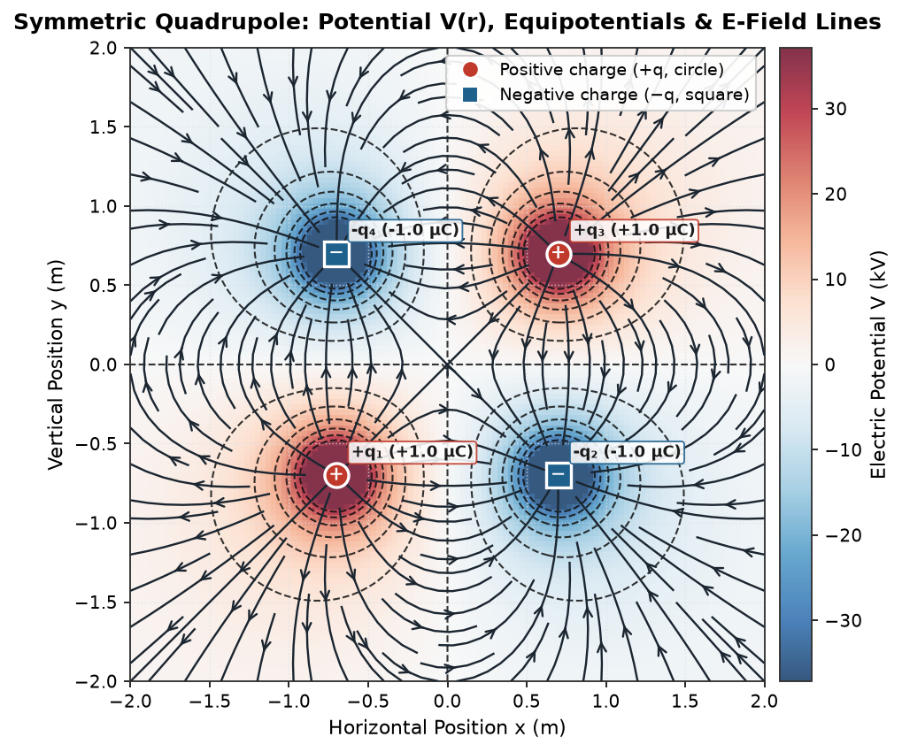
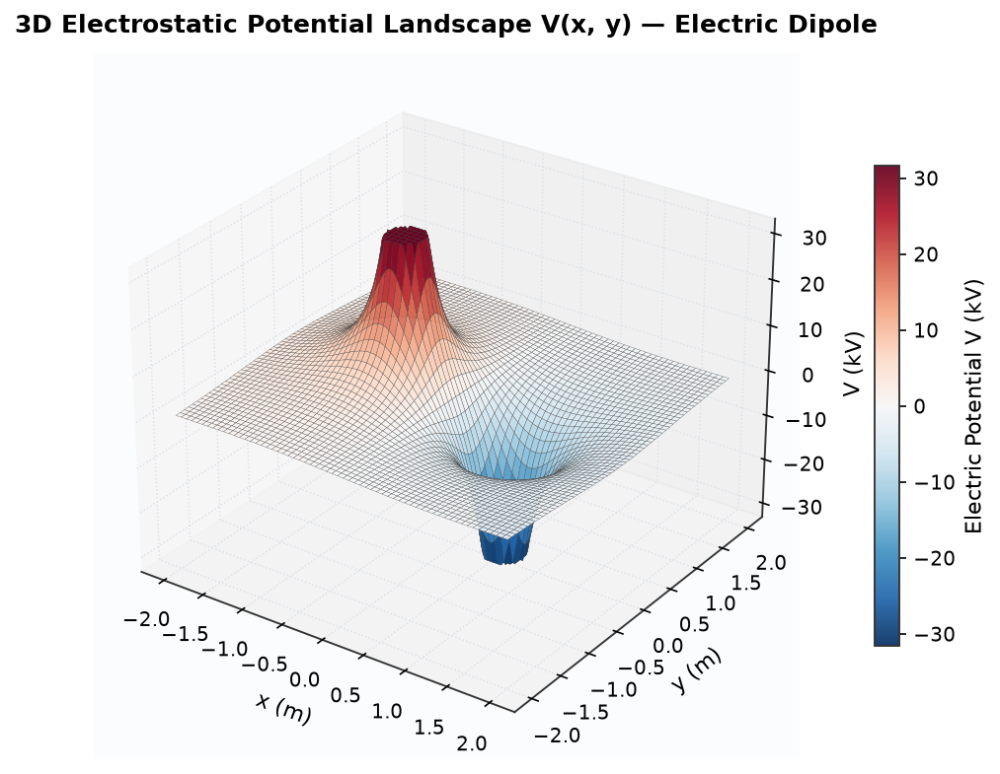
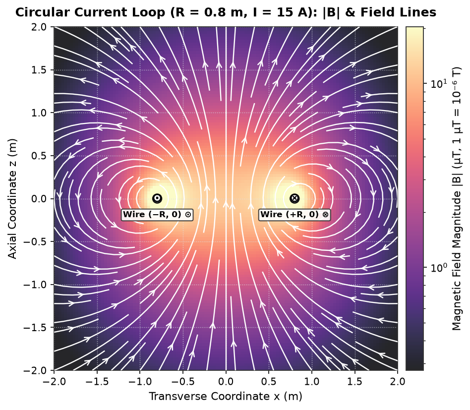
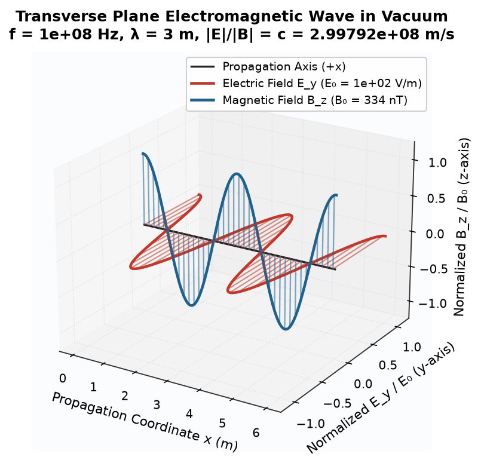

# Invisible Physics — See the Unseen

**An Interactive Physics Visualization & Numerical Computation Laboratory Built with Python & Jupyter**

[](LICENSE)
[](pyproject.toml)
[](../../actions/workflows/tests.yml)

**Invisible Physics** is an open-source scientific computing and interactive visualization laboratory exploring electromagnetic phenomena through vectorized NumPy computation, analytical special functions, and publication-grade Matplotlib graphics.

Rather than offering static decorative diagrams, this repository provides a reusable, unit-tested Python package (`invisible_physics`) paired with five executable Jupyter Notebooks that allow students, educators, and engineers to manipulate physical parameters, inspect field topologies, and verify numerical computations against exact analytical laws.

---

## 1. Scientific Motivation

Classical electromagnetism is governed by vector and scalar fields—$\mathbf{E}(\mathbf{r}, t)$, $V(\mathbf{r})$, $\mathbf{B}(\mathbf{r}, t)$, and the Poynting energy flux $\mathbf{S}(\mathbf{r}, t)$—that permeate space invisibly. Learners frequently encounter two obstacles when bridging textbook equations and physical intuition:
1. **Multi-source superposition & geometry**: Analytical formulas are easy to write for a single point charge or on the symmetry axis of a current loop, but building intuition for off-axis fields, saddle null points, and equipotential orthogonality requires 2D and 3D spatial visualization.
2. **Numerical singularities & idealizations**: Classical point charges ($1/r^2$) and thin wire filaments ($1/r$) diverge as evaluation distance $r \to 0$, and point magnetic dipoles ($1/r^3$) are frequently confused with finite bar magnets.

**Invisible Physics** addresses both challenges by combining:
- **Exact SI-unit vectorized physics engines** (NIST CODATA 2022 constants).
- **Explicit, documented singularity regularization strategies** (`core_cutoff`, `softening`, and `mask`) with core-radius indicators.
- **Accessible, colorblind-safe scientific visualizations** (diverging colormaps for signed potentials, sequential colormaps for field magnitudes, distinct marker shapes and glyphs for $+q$ vs. $-q$ and $\odot$ vs. $\otimes$).
- **Automated numerical validation** comparing finite-difference gradients ($-\nabla V$), root-solved null points, and complete elliptic integrals against exact analytical solutions.

---

## 2. Visual Gallery (Generated Directly by `invisible_physics`)

### Electrostatic Field Streamlines & Magnitude ($|\mathbf{E}|$)


### Symmetric Quadrupole: Potential $V(\mathbf{r})$, Equipotentials & $\mathbf{E} = -\nabla V$ Orthogonality


### 3D Electrostatic Potential Landscape $V(x, y)$


### Circular Current Loop Magnetic Field (Exact Off-Axis Elliptic Integral Solution)


### Transverse Plane Electromagnetic Wave in Vacuum ($\mathbf{E} \perp \mathbf{B} \perp \mathbf{k}$)


---

## 3. Key Features

- **Module 1 — Electric Field Explorer (`electrostatics.py`)**:
  - Fully vectorized 2D Coulomb field computation $\mathbf{E}(\mathbf{r}) = \frac{1}{4\pi\varepsilon_0}\sum_i q_i \frac{\mathbf{r}-\mathbf{r}_i}{\|\mathbf{r}-\mathbf{r}_i\|^3}$ with input charges in $\mu\text{C}$ converted to SI ($\text{C}$).
  - Three selectable singularity strategies (`core_cutoff`, `softening`, `mask`) and boolean `core_mask` tracking.
  - Preset configurations: single positive, single negative, dipole, two like charges, unequal opposite charges, symmetric quadrupole, and three-charge neutral triangle, plus interactive multi-charge controls.
- **Module 2 — Electric Potential Landscape (`electrostatics.py`, `validation.py`)**:
  - 2D diverging heatmaps, labeled equipotential contours, combined field-potential orthogonality views, and 3D potential surfaces.
  - Second-order central finite-difference gradient solver `numerical_field_from_potential()` with $\mathcal{O}(\Delta x^2)$ convergence verification against direct Coulomb calculations.
- **Module 3 — Magnetic Field Lab (`magnetism.py`)**:
  - Infinitely long straight wire ($B = \mu_0 I / (2\pi r)$) demonstrating right-hand rule circulation ($\odot$ vs. $\otimes$).
  - Exact off-axis circular current loop solver in the $x$-$z$ plane via complete elliptic integrals $K(m)$ and $E(m)$ (`scipy.special.ellipk`, `ellipe`), verified against the exact on-axis Biot–Savart formula.
  - Point magnetic dipole far-field model with explicit core exclusion and comparison against finite current loops.
- **Module 4 — Electromagnetic Wave Lab (`waves.py`)**:
  - Vacuum plane-wave model (`PlaneWaveVacuum`) strictly enforcing $c = f\lambda$ and $|\mathbf{E}| = c|\mathbf{B}|$ while rejecting contradictory independent parameter settings.
  - Instantaneous Poynting vector $\mathbf{S} = \frac{1}{\mu_0}(\mathbf{E} \times \mathbf{B})$, electromagnetic energy density $u_{\text{EM}}$, and dielectric wavelength comparison.
- **Module 5 — Reproducible Physics Experiments (`validation.py`)**:
  - Hypothesis-driven experiments testing charge linearity, $1/r^2$ vs. $1/r$ power-law slopes, Brent root-finding for zero-field stagnation points, $-\nabla V$ convergence, and singularity regularization sensitivity.

---

## 4. Repository Structure

```text
invisible-physics/
├── README.md
├── LICENSE
├── CITATION.cff
├── requirements.txt
├── pyproject.toml
├── .gitignore
├── .github/
│   └── workflows/
│       └── tests.yml
├── notebooks/
│   ├── 01_electric_field_explorer.ipynb
│   ├── 02_electric_potential_landscape.ipynb
│   ├── 03_magnetic_field_lab.ipynb
│   ├── 04_electromagnetic_wave_lab.ipynb
│   └── 05_physics_experiments.ipynb
├── src/
│   └── invisible_physics/
│       ├── __init__.py
│       ├── constants.py
│       ├── electrostatics.py
│       ├── magnetism.py
│       ├── waves.py
│       ├── visualization.py
│       └── validation.py
├── tests/
│   ├── test_electrostatics.py
│   ├── test_magnetism.py
│   ├── test_waves.py
│   └── test_validation.py
├── examples/
│   └── example_experiments.py
└── docs/
    ├── figures/
    ├── physics.md
    ├── experiments.md
    └── limitations.md
```

---

## 5. Installation & Environment Setup

Create and activate an isolated Python virtual environment (requires Python $\ge 3.10$):

```bash
python -m venv .venv
```

**Activate on Windows PowerShell:**
```powershell
.venv\Scripts\Activate.ps1
```

**Activate on Linux / macOS:**
```bash
source .venv/bin/activate
```

**Install the package in editable mode with development and notebook dependencies:**
```bash
python -m pip install -e ".[dev]"
```

*(Alternatively, you can install pinned dependencies via `python -m pip install -r requirements.txt` followed by `python -m pip install --no-deps -e .`)*

---

## 6. Launching JupyterLab & Notebook Guide

Start JupyterLab from the repository root:

```bash
jupyter lab
```

Then open any of the five notebooks inside `notebooks/`:

| Notebook | Description |
| :--- | :--- |
| [`notebooks/01_electric_field_explorer.ipynb`](notebooks/01_electric_field_explorer.ipynb) | **Flagship Module**: Coulomb's law, vector quiver maps, streamlines, 7 charge configurations, and interactive `ipywidgets` multi-charge studio. |
| [`notebooks/02_electric_potential_landscape.ipynb`](notebooks/02_electric_potential_landscape.ipynb) | Scalar potential $V(\mathbf{r})$, equipotential contours, 3D potential hills/wells, $V=0$ vs. $\mathbf{E}=\mathbf{0}$ comparisons, and $\mathcal{O}(\Delta x^2)$ numerical gradient verification. |
| [`notebooks/03_magnetic_field_lab.ipynb`](notebooks/03_magnetic_field_lab.ipynb) | Straight wire right-hand rule, exact circular current loop field via elliptic integrals, on-axis validation, and comparison with the point magnetic dipole approximation. |
| [`notebooks/04_electromagnetic_wave_lab.ipynb`](notebooks/04_electromagnetic_wave_lab.ipynb) | Transverse plane electromagnetic waves in vacuum ($c = f\lambda$, $\|\mathbf{E}\| = c\|\mathbf{B}\|$), 3D orthogonal vectors, Poynting flux $\mathbf{S}(x, t)$, and dielectric dispersion. |
| [`notebooks/05_physics_experiments.ipynb`](notebooks/05_physics_experiments.ipynb) | Seven structured, hypothesis-driven quantitative experiments comparing numerical outputs against exact analytical formulas. |

> **Note on Interactive Controls (`ipywidgets`)**: Interactive sliders and dropdowns render automatically in **JupyterLab 4+**, **Jupyter Notebook 7+**, and **VS Code Jupyter**. In static viewers (such as GitHub's web preview), pre-executed default plots and numerical tables are preserved in every notebook output cell.

---

## 7. Running Command-Line Experiments & Automated Tests

To run the standalone verification script and regenerate all documentation figures in `docs/figures/`:

```bash
python examples/example_experiments.py --no-show
```

To run the automated `pytest` suite verifying analytical accuracy, inverse-square scaling, superposition, symmetry, singularity handling, and wave constraints:

```bash
pytest
```

---

## 8. Scientific Assumptions & Limitations

All physical idealizations and numerical limitations are documented in detail in [`docs/limitations.md`](docs/limitations.md) and [`docs/physics.md`](docs/physics.md):
- **Point-charge and thin-wire singularities**: Classical $1/r^2$ and $1/r$ divergences as $r \to 0$ are regularized using an explicit cutoff radius `r_min` (default $0.05\ \text{m}$) with selectable `core_cutoff`, `softening`, or `mask` behavior.
- **Point magnetic dipole vs. real bar magnets**: The point magnetic dipole model ($\propto 1/r^3$) is a far-field asymptotic approximation ($r \gg L$) and does not model the internal field of a finite physical bar magnet.
- **Static vs. radiative regimes**: Electrostatics and magnetostatics modules model time-independent sources ($\partial/\partial t = 0$), whereas the wave module models source-free propagating plane waves in vacuum.
- **Finite-difference truncation error**: Numerical differentiation $\mathbf{E}_{\text{num}} = -\nabla V$ has truncation error $\mathcal{O}(\Delta x^2)$ outside singularity cores and should not be evaluated across the $r = r_{\min}$ derivative boundary.

---

## 9. Citation & Contributing

If you use **Invisible Physics** in coursework, educational materials, or scientific computing demonstrations, please see [`CITATION.cff`](CITATION.cff). Contributions, bug reports, and additional analytical benchmarks are welcome via pull requests; please ensure all existing and new `pytest` checks pass before submitting.

## 10. License

Released under the [MIT License](LICENSE).

## Author

Built by **Dipesh Sapkota** ([@Dszae](https://github.com/Dszae)), a Computer Engineering student at IOE Thapathali Campus, Kathmandu, Nepal. More projects at [dipeshsapkota7.com.np](https://www.dipeshsapkota7.com.np/).
